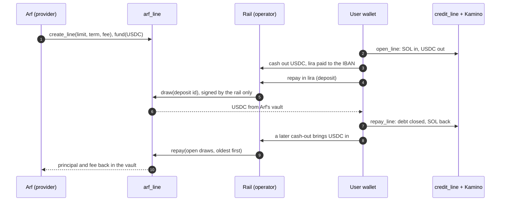
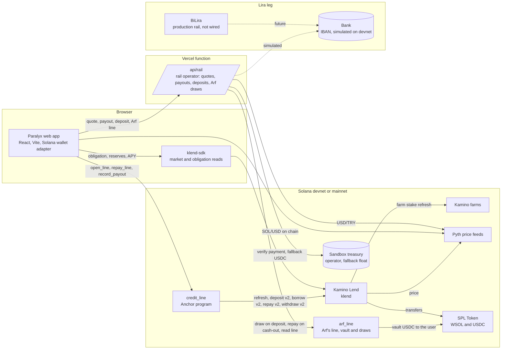

<p align="center"></p>

# Paralyx × Arf

**Turkish lira liquidity on Solana, settled from an on-chain Arf credit line.**

Paralyx lets a crypto holder in Türkiye get lira without selling their SOL: post SOL to Kamino Lend, borrow USDC, cash it out as lira, repay in lira. The hard part is the repayment. The user wires lira and expects the debt to shrink now, but the rail only has USDC once it has converted that lira, so every rail operator keeps USDC idle to settle at once. [Arf](https://arf.one) removes that prefunding for licensed payment companies with short-term USDC liquidity.

This repository brings Arf's model on chain. **`arf_line`** is an Anchor program in which Arf's USDC waits in a vault and the licensed rail operator draws it within Arf's limit, term and fee, exactly once per deposit, repaid oldest first. Every lira repayment in Paralyx now settles from an Arf draw in seconds, and every cash-out pays Arf back.

Built for the [Arf × Superteam Türkiye University Track](https://superteam.fun/earn/listing/arf-superteam-turkiye-university-track) · submission kit in [docs/arf-track](docs/arf-track/README.md)

| | |
|---|---|
| **Arf's role** | Short-term USDC for the licensed rail operator, so a lira repayment settles without a prefunded float |
| **On chain (devnet)** | `arf_line` [`ARF4tQPA…dvAoC`](https://explorer.solana.com/address/ARF4tQPAqQdGScZK7kF2yWK4tpkp99mPpEkr2rtdvAoC?cluster=devnet), its line [`7zLBPHXS…WSTer`](https://explorer.solana.com/address/7zLBPHXSMZ8xY2ep9CBX65zWVh1UERZK3J1yHvWwSTer?cluster=devnet), and Paralyx's `credit_line` [`PLXama5S…yG6qr`](https://explorer.solana.com/address/PLXama5SomfMXpUzgwAVhDXMJrESMX8JP93RGRyG6qr?cluster=devnet) |
| **Enforced by the program** | A limit on what is outstanding, a term of one to five days, a fee of at most 500 bps, Arf's freeze, one draw per deposit, oldest-first repayment, no new draw while one is overdue |
| **Proof** | Every path ran on devnet and is linked below; 26 program tests and 28 client tests |
| **Still a sandbox** | The lira leg is simulated, and the capital is devnet USDC from a key standing in for Arf. Arf is not a partner of this project |

Source: this repository, which continues [wienerlabs/paralyx-solana](https://github.com/wienerlabs/paralyx-solana) branch `solana-port`. The upstream app, without the Arf line, runs at [paralyx.wienerlabs.xyz](https://paralyx.wienerlabs.xyz).

## Contents

1. [Özet (TR)](#özet-tr)
2. [Why Arf](#why-arf)
3. [How it works](#how-it-works)
4. [The arf_line program](#the-arf_line-program)
5. [The rail on Arf](#the-rail-on-arf)
6. [Proof on devnet](#proof-on-devnet)
7. [What is real and what is a sandbox](#what-is-real-and-what-is-a-sandbox)
8. [Architecture](#architecture)
9. [The credit_line program](#the-credit_line-program)
10. [The app](#the-app)
11. [The fiat rail](#the-fiat-rail)
12. [Integrations and why they are load-bearing](#integrations-and-why-they-are-load-bearing)
13. [Tests](#tests)
14. [Deployed artifacts](#deployed-artifacts)
15. [Run it](#run-it)
16. [Design decisions](#design-decisions)
17. [Regulatory posture](#regulatory-posture)
18. [Roadmap](#roadmap)
19. [Lineage](#lineage)
20. [Team](#team)

## Özet (TR)

Paralyx, kripto varlığını satmak istemeyen ama liraya ihtiyacı olan kullanıcı için teminatlı bir likidite hattı. SOL, Kamino Lend piyasasına teminat olarak konur, USDC borç alınır ve bu USDC lira rayı üzerinden IBAN'a lira olarak ödenir. Geri ödeme de lirayla yapılır.

Asıl zorluk geri ödemede. Kullanıcı lira gönderir ve borcunun hemen kapanmasını bekler. Ama ray operatörünün elinde USDC ancak o lirayı çevirdikten sonra olur. Bu yüzden her operatör, anında ödeme yapabilmek için USDC'yi atıl bekletir; buna önceden fonlama denir. Arf, İsviçre'de düzenlenmiş bir likidite ve takas platformu. Lisanslı ödeme şirketlerine 1 ila 5 gün vadeli, alacağa dayalı USDC likiditesi vererek bu önceden fonlama ihtiyacını ortadan kaldırıyor.

Bu repo Arf'ın modelini zincire taşıyor. `arf_line` bir Anchor programı:

- Arf'ın sermayesi programın kasasında durur.
- Lisanslı ray operatörü, Arf'ın limiti, vadesi ve ücreti içinde Arf'tan her seferinde imza almadan çekiliş yapar.
- Her çekiliş, mevduat referansıyla açılan ayrı bir hesaptır; aynı mevduat ikinci kez çekilemez.
- Geri ödemeler en eski çekilişten başlar; vadesi geçmiş bir çekiliş varken program yeni çekilişe izin vermez.
- Arf hattı istediği an dondurabilir ve kullanılmayan parasını geri alabilir.

Paralyx'te lirayla yapılan her geri ödeme artık bir Arf çekilişiyle saniyeler içinde kapanıyor. Her nakit çekim de gelen USDC ile Arf'a geri ödeme yapıyor.

Devnet'te tüm akış gerçek programla çalıştı ve her işlem aşağıda bağlantılı. Lira bacağı ise hâlâ bir simülasyon. Kasadaki sermaye, Arf'ın yerine geçen bir test anahtarının koyduğu devnet USDC'si. Arf bu projenin ortağı değil: herkese açık bir API'si yok ve sadece lisanslı kurumlarla çalışıyor. Üretimde hattın operatörü Paralyx değil, lisanslı ray operatörü olur.

## Why Arf

A lira credit line has two legs, and only one of them is easy for the rail. On a **cash-out**, USDC arrives and the rail pays lira. On a **repayment**, the user wires lira and expects the Kamino debt to shrink now. But the rail holds USDC only after it has converted that lira, which takes minutes to days depending on the bank and the conversion venue. To settle at once, the operator keeps USDC idle on every corridor. Upstream Paralyx's sandbox treasury was that float.

[Arf](https://arf.one) exists for this problem. It is a liquidity and settlement platform regulated in Switzerland. It lends short-term USDC, repaid in 1 to 5 days and backed by receivables, to licensed payment companies, so they settle without prefunding. A line from Arf comes down to a limit, a tenor and a fee, and Arf reports its activity on chain.

So Arf here is not a logo on a screen. It becomes the source of the USDC on the repayment leg, and the cash-out leg pays it back.

| | Prefunded float | Arf line on `arf_line` |
|---|---|---|
| Where the USDC comes from | The operator's own capital, idle on every corridor | Arf's capital in a vault, drawn when a deposit arrives |
| When the float is short | The repayment waits | It settles from a draw in seconds |
| Who enforces the rules | The operator's server | The program: limit, term, fee, freeze, one draw per deposit, oldest-first repayment |
| Who can audit it | Nobody outside | Anyone: every draw is an account, every repayment an event |
| Who signs a draw | The operator | The operator only; Arf committed once, when it opened and funded the line |

## How it works

1. **Arf opens a line** with the licensed rail operator: `create_line` sets the limit, the term and the fee, and `fund` puts USDC in the line's vault.
2. **The user borrows.** SOL goes to Kamino through Paralyx's `credit_line` and USDC comes out. The user cashes some of it out as lira.
3. **The user repays in lira.** The rail checks the line, then signs `draw` with the deposit id as the reference. USDC goes from Arf's vault straight to the user's account, and `repay_line` closes the Kamino debt in the next transaction. The receipt says "Funded by Arf draw #n".
4. **Cash-outs pay Arf back.** Each confirmed cash-out brings USDC to the rail treasury. The rail then calls `repay`, closing open draws oldest first, fees included.
5. **When the line cannot lend** (frozen, overdue, over the limit, or the vault is short), the treasury float pays and the receipt says why.



## The arf_line program

`contracts/arf_line` is an Anchor 1.2 program, separate from `credit_line`. The line is an agreement between Arf and the rail operator, not part of a user's credit line. The program escrows the lender's capital and keeps the ledger of what the operator owes.

| Instruction | Signer | What it does |
|---|---|---|
| `create_line(limit, term_seconds, fee_bps)` | provider (Arf) | Creates the `Line` PDA (seeds `line`, provider, operator, mint) and its vault, a token account the line owns (seeds `vault`, line). The term must be one to five days, the fee at most 500 bps, the limit above zero |
| `fund(amount)` | provider | Moves the provider's tokens into the vault |
| `withdraw(amount)` | provider | Moves tokens out of the vault, at most what it holds; what is lent out is not in the vault |
| `set_terms(limit, term_seconds, fee_bps, frozen)` | provider | Changes the terms for new draws, or freezes the line. The term changes only while no draw is open |
| `draw(reference, amount)` | operator (the rail) | Creates the `Draw` PDA (seeds `draw`, line, reference) and pays the amount from the vault to any token account of the mint. Refused while the line is frozen, while the oldest open draw is past due, when the outstanding amount with this draw and its fee would pass the limit, or beyond the vault. The fee is rounded up, the due date is now plus the term |
| `repay(amount)` | anyone | Takes the open draws from the oldest as remaining accounts, pays each what it owes until the amount runs out, and moves only what was applied from the payer's account to the vault. When draws stay open the next open draw has to be passed too, so the line always knows the oldest due date |

Accounts: `Line` holds the provider, operator, mint and vault, the terms, `frozen`, the running `outstanding` (principal and fees not yet repaid), the cumulative `drawn`, `fees` and `repaid`, `next_seq`, and `head_seq` and `head_due_at` for the oldest open draw. `Draw` holds the line, `seq`, the destination account, `amount`, `fee`, `repaid`, `drawn_at`, `due_at` and the reference. The reference comes last, so every other field sits at a fixed offset. Both carry a version byte and reserved bytes. Events: `LineCreated`, `LineFunded`, `LineWithdrawn`, `TermsSet`, `Drawn`, and one `Repaid` per draw a repayment touches, all through `emit_cpi`. Errors start at 7100: `EmptyAmount`, `InvalidReference`, `InvalidLimit`, `InvalidTerm`, `InvalidFee`, `Frozen`, `Overdue`, `LimitExceeded`, `InsufficientLiquidity`, `NothingToRepay`, `DrawOutOfOrder`, `MissingHead`, `NotADraw`, `WrongLine`, `OpenDraws`, `NotProvider`, `NotOperator`, `AmountOverflow`.

Patterns worth pointing at:

- **No signature from Arf per draw.** A credit line is a commitment. Arf sets the limit, term and fee once and the program enforces them, so the rail can settle at three in the morning without waking a signer. Arf keeps two levers: freezing the line and withdrawing what is not lent out.
- **Exactly once, on chain.** The draw account is seeded by the reference, the deposit id, so a second draw for one deposit fails when the account is created, whatever the server does. In the devnet run two settles of one deposit raced: one draw landed, and the other transaction failed with "account already in use".
- **First in, first out with a cursor.** Each draw takes the next sequence number, and the term cannot change while draws are open, so due dates rise with the sequence. Repayments start at the head, so the line needs only `head_seq` and `head_due_at` to refuse a new draw while the oldest is overdue, without walking every draw.
- **Anyone can repay.** Paying a debt early harms nobody, and the program moves only what is owed.

Limits, stated plainly:

- **The vault is custody.** Unlike `credit_line`, this program holds funds: the lender's capital. Whoever holds its upgrade authority could ship code that moves them; on devnet that is the deployer `33qU3JFk…QC51REWhjKh`. Before mainnet it needs an audit, the authority under a multisig of Arf and the operator or a timelock, and a verifiable build.
- **Transfer-fee mints.** Amounts are recorded as sent. A Token-2022 mint with a transfer fee would leave the vault with less than the ledger says. USDC has no such fee, and the program does not refuse such mints.
- **One mint and one operator per line.** A second corridor or a second operator is a second line.
- **Draw accounts stay open.** They are the exactly-once record, so they are never closed; each costs the operator about 0.0022 SOL of rent.

## The rail on Arf

The rail is the server side of the lira leg (`web/api/rail.ts`). It holds the treasury key, which is the line's operator, and never Arf's key. Its only Arf setting is `ARF_LINE`, the line's address.

- **Draw.** `settle` reads the line and checks it the way the program will: not frozen, oldest open draw not past due, the outstanding amount with this draw and its fee within the limit, enough in the vault. If the line can lend, the treasury signs one `draw` with the deposit id as the reference, paying the user's USDC account straight from Arf's vault. If a settle finds the draw account already there, it returns that draw. If it loses a race to the same deposit, it returns the winning draw instead of failing.
- **Repayment.** Confirming a cash-out repays open draws, oldest first, with the USDC in the treasury. It pays up to eight per transaction, the last one partly if the USDC runs out, and passes the next open draw as the program requires. If the repayment fails, the payout stands and the receipt says the rail repays Arf on the next cash-out. `POST /api/rail?action=arf-sweep` repays on demand.
- **Refusal.** When the line cannot lend, the deposit falls back to the treasury float and the receipt says why: `frozen`, `overdue`, `limit` or `liquidity`. With no float either, settle fails and names both reasons.
- **Ledger.** There is no database and no history scan. `GET /api/rail?action=arf` reads the line and its vault in one call and the line's draw accounts in another (`getProgramAccounts` filtered by the draw discriminator and the line). It refuses a line run by another operator, a line for another mint, and an account owned by another program.
- **Terms.** They live in the line account, and only Arf changes them (`scripts/arf.mjs terms`). The devnet values (limit 500 USDC, 3 days, 10 bps) are placeholders, not Arf's pricing, which is agreed per partner and not public.

On screen, the Takas page shows the line next to the exchange card: what is available against the limit, what is outstanding, the USDC in the vault, the term, the fee and whether Arf froze the line. It also lists the last draws by sequence with their due date and status, each linked to its draw account, plus links to the program, the line and the vault. Every lira receipt names the draw that funded it, and every cash-out receipt shows how much went back to Arf.

## Proof on devnet

### The Arf line on devnet

The `arf_line` program was deployed on 14 October 2026. The line [`7zLBPHXS…WSTer`](https://explorer.solana.com/address/7zLBPHXSMZ8xY2ep9CBX65zWVh1UERZK3J1yHvWwSTer?cluster=devnet) ran against it, with the rail served locally by the Vite dev server from test keys:

- Arf, the provider: `CAxiHh3N…oaNU5W`
- The rail treasury, the operator: `79BqoW6S…jekm2D`
- The user: `HjZ79Xwi…dByG2`

The app rows ran in the browser with the burner wallet `BTCHsmL8…VMSFg`. The rail held only the treasury key: after funding the line, Arf signed nothing but the two term changes.

| Step | Transactions |
|---|---|
| Deploy `arf_line`: 294,304 bytes, sha256 `97163f4792cdff7c5274b95f3e9bfaedc115724df1d3fcd78f445d25bc775508`; `solana program dump` returns the same bytes | [`aujiJ6k6…`](https://explorer.solana.com/tx/aujiJ6k6EdQ17HmX2PswHhpkxt8Db7b2aYcW6K7ZRTYKVADu7RqWRM8fc1BFaWwfwN3qpYQK5DXdfE7vUkm9Cnp?cluster=devnet) |
| `create_line`: Arf as provider, the rail treasury as operator, devnet USDC, limit 500 USDC, 3 days, 10 bps | [`5aDYnbxr…`](https://explorer.solana.com/tx/5aDYnbxrjwvSvDLD5UBKMjxfgVH7bvjwyGGxTsCqU5Hqsz8JWApULAv7bjyeQhv1vTDE66Re7xPjdDc5UMqkwfEY?cluster=devnet) |
| `fund`: Arf puts 4.99 USDC into the vault | [`xoGptccX…`](https://explorer.solana.com/tx/xoGptccXjXbjqA5rQWPf26cwdeQVnciVznzeKWvpYxe5CqRLJmws3T6jdTi9MZ8GB9DGmwTCTPhEGhf83B8NEw1?cluster=devnet) |
| ₺100 deposit: `draw` #0, 2.015127 USDC from the vault straight to the user, fee 2,016 units, due in 3 days, signed by the rail alone; then `repay_line` | [`k2VeJ1kT…`](https://explorer.solana.com/tx/k2VeJ1kTcRv8Kzyh2YuD45UJqYUyKDxzqMLZNW7zGLSG92hc3QsFNrrMHdhyM4owLBE3LPiyerf56M3LEgTsAAg?cluster=devnet), [`3uLkW7qL…`](https://explorer.solana.com/tx/3uLkW7qL4j15DNwGjyYs4fHtNYKRkCh7cE4hpyUW2PDCgFEZhDFPqR86rZnMCmyZA11U4rGDSKLzB8mwNaxWTNh8?cluster=devnet) |
| ₺100 deposit: `draw` #1 | [`3t1pGSyF…`](https://explorer.solana.com/tx/3t1pGSyFbrPtKvxaooNLrjmoDPmY2AgBosbkWm8CS5325vB1Qdk4dE6yynEiSnyeqL5Lik7e7wKNzwP81HNoYfXL?cluster=devnet) |
| Cash out 3 USDC; confirming it calls `repay` for #0 and #1, 4.034286 USDC with fees, oldest first | [`2d1RYd4o…`](https://explorer.solana.com/tx/2d1RYd4oeLuKjMSipQmuovB5KWRPRgvUpAi3yRZmdSFsDF6CdbvNHX5cHRhudZr2x1qtSPmZG77Ks47bKjAcuAZP?cluster=devnet) |
| One ₺50 deposit settled twice at the same moment: `draw` #2 lands, the second draw fails on chain with "account already in use", and both calls return #2 | [`62VRqKsi…`](https://explorer.solana.com/tx/62VRqKsi6PXzStV5G8RL42TjCWe5KiCF2MoBKguwnxp7URXJMkBQ1DuHZGagzCjz8p1UhMgf7kLGbLEFK6Lu2z7Z?cluster=devnet), [`2et3r1Zg…`](https://explorer.solana.com/tx/2et3r1ZgVRZCRwJCvfUmW1UAs1jZLCYF68peSNAVCH5bSDfMGBigbMRf7wQX5qod7VS4UrWXWVzVFQxqakKCx3ux?cluster=devnet) |
| `set_terms` lowers the limit to 1 USDC; a ₺50 deposit is refused with `limit` and paid from the treasury float | [`3SwoEjsx…`](https://explorer.solana.com/tx/3SwoEjsx1AbqkCH5u4TFFdsWK3odeTcVoEgF6NfAQtPL545tVUdGrzrz8NVUvCnfEnq8gcJFH3apxuRXMzwpYzAv?cluster=devnet), [`2CSG4Qbm…`](https://explorer.solana.com/tx/2CSG4Qbm1aeEgniG9NSbvBvbUmmKU3LXWcM52zf48wcxgK8gdB17zJrRQiB9aYyR5G541DxGuLKNTsXXpkXLhRUS?cluster=devnet) |
| Cash out 2 USDC repays #2 | [`52rDKNnR…`](https://explorer.solana.com/tx/52rDKNnRV44pmvNNJWWXDXzU8fL2FwjD3d2bssMjgspmNDUs3VeGHhaZQ5HsVuiQReP4DPSpPqG9zfMvVMQXH3zL?cluster=devnet) |
| `set_terms` freezes the line and a deposit is refused with `frozen`; then the terms are restored | [`3htgaAmj…`](https://explorer.solana.com/tx/3htgaAmj8UYnbc7QzjSakLDV23JyyWPjzsyBQLQS4YFXgiSYzMKNdf49s8Er4h6NzYdDVcPcHDVoLuE4govR5kpQ?cluster=devnet), [`2Se6UMB3…`](https://explorer.solana.com/tx/2Se6UMB31a7MfBkx9MLWHZ3vFsyDAa6B2m1Cebqpv47P17EKAELwa6LPicfCbycxA7k6MZuBd1tZ8ybcH1zxiCzK?cluster=devnet) |
| App: repay ₺50, funded by `draw` #3; the whole debt is repaid and 0.05 SOL comes back | [`3BEW9i1m…`](https://explorer.solana.com/tx/3BEW9i1mihmPwzz3p4Cc6ToeyKZunTbWxs8Pkok3Hha7AvgwBtcCCSVKRpYjiMryWsbJtB8B4egN34WUyrnsXNJF?cluster=devnet), [`dc3v25rr…`](https://explorer.solana.com/tx/dc3v25rrrXgEU3uzuTphFXYhmWRuJwvZKbPmm9LMsQxeY5w8JxkkW5woZEA3yAPEvVMiP5ezVLJJBpjD4fw2and?cluster=devnet) |
| Cash out 1 USDC repays #3 | [`5x1wSRhV…`](https://explorer.solana.com/tx/5x1wSRhVKKFTipA6Hzq6wtZ1JtPWu34poMAwTgxQREQUzdRTzbTXTgMQM7VRAF8nT5tYWCfjmmTm5zSRx9Mc9m77?cluster=devnet) |

At one point the limit was 1 USDC and the float held too little; settle then answered 409, named both reasons and sent no transaction. After the run the line has made four draws and all are repaid. The vault holds 4.996048 USDC: the 4.99 Arf put in plus 6,048 units of fees.

A first version on 13 October kept the ledger in signed memos on a keypair the rail held; the README at commit `801c958` lists that run. It found a bug: a partial repayment and a borrow without new collateral failed with `AccountNotInitialized`, because `repay_line` and `open_line` need the wrapped SOL account that `open_line` closes after a deposit. Both builders now create it every time ([`3sqRzMYW…`](https://explorer.solana.com/tx/3sqRzMYWTCHt68U5KGotWqKw2C9iXduCZSEonuoVyZNaE8SXqcjguxTSokYcwHaaGaug2TxjD27Wa3NPtSW2FfW6?cluster=devnet) and [`VBbu9yCf…`](https://explorer.solana.com/tx/VBbu9yCfnGjfqFAhDPXv7DxvZet1miPD7nL9QJ5A3MGxstKNnaZkQTtbfm8LyL2KtHChgcbhd1ni3nCHrAU8UM5?cluster=devnet) after the fix). Upstream still has the bug.

### Paralyx on devnet, before Arf

Upstream ran the base loop on 9 October 2026: deploy, configure, connect, open a line, sandbox cash-out, lira repayment from the treasury float, reopen. The app steps ran in a browser against a local production build, with the wallet adapter's burner wallet (`HkjN4VM1PLwTrMUZnEndkUx7CJmnSnXwCgnVVUuwdN5e`, funded from the deployer).

| Step | Signer | Transaction |
|---|---|---|
| Deploy `credit_line` | deployer | [`4VCqjXWX…`](https://explorer.solana.com/tx/4VCqjXWXUVfZUvc73xDGcYhxkBLB1xA6shpaLeXUwK95uuWK2FUZYD1pU6UHy4ybnhn2KNWi17Nu2dDBbbV7L5vd?cluster=devnet) |
| `initialize`: config with the klend program, the market and both reserves | upgrade authority | [`r17ASwnd…`](https://explorer.solana.com/tx/r17ASwndoJgv8WRDKducqaisxzwMuF5n63jcukKEdpX9LAdgFt21fwD6kfq42EGkYXnXh52r3foQ3E6RUn69NWB?cluster=devnet) |
| Sandbox treasury USDC account and fee SOL | deployer | [`45xPk7Lo…`](https://explorer.solana.com/tx/45xPk7LoYQcB2xtGH42kbRbZ37h2nVK1SBda8VAbmYkNAU534G8ZXWpv86swa7o6Bq95KHyfdhTdREHRKHA3pBoc?cluster=devnet) |
| `open_line` from `scripts/open-line.mjs`: 1 SOL in, 20 USDC out | deployer | [`37wDTyp8…`](https://explorer.solana.com/tx/37wDTyp8N3eMDbyVWsp2y5acLhM4ZWVrCYzAnCPjeVUr9GGc8L2Am1PWTGBWLVwFd9TkU2uTgxRHdLwAvkN9Axqj?cluster=devnet) |
| Those 20 USDC become the sandbox treasury float | deployer | [`ZAoo6ATj…`](https://explorer.solana.com/tx/ZAoo6ATjkMu8ri6UFU17D2zm2jtuY57TTT4UUu3mZepPFSRCZXgjvd6rkVW1qtYzKCfBL4eG7pDgs4HMDaGqUKP?cluster=devnet) |
| App: open a line, 1 SOL in, 10 USDC out, one signature | test wallet | [`4UTFdUGf…`](https://explorer.solana.com/tx/4UTFdUGfxLK1bTar5S2RYN5P6XhM6btJNYREhpbvqVbWQUzCkqeqGabQfndmoHDZS6kjUGwen1Qmg86fLoLnYxN5?cluster=devnet) |
| App: cash out 4 USDC to the sandbox rail with memo `SBX-PO-B7C18EB276` | test wallet | [`4AmAjSSb…`](https://explorer.solana.com/tx/4AmAjSSbryGWKpHtDmgAk6YdvpDcrD7RSHeUjE6ndrzSc74NpKLSRtJeFKPZtugFn2L6oGdZHhGjLZJJaHygqJra?cluster=devnet) |
| App: `record_payout` of ₺196.34 for rail order `SBX-PO-B7C18EB276` (simulated bank reference `SBX-444E0A0A6F`) | test wallet | [`2Ttjg9yq…`](https://explorer.solana.com/tx/2Ttjg9yqJ7XPGgb6TWfhBwVEJLpvEuLqegToMpDqeq5r3kJAdkgjWFCNouPD7tUhvKX6a3jkM25B2davfi4rAyW4?cluster=devnet) |
| Rail: settle a simulated ₺499 deposit (`SBX-DP-ED0DF3D9E8`) with 10.0645 USDC from the treasury | sandbox rail | [`4R9dQ4QU…`](https://explorer.solana.com/tx/4R9dQ4QU1xnNtLnsr56NAj7igHnHs3iPGUqjcrjSgfncgLQuQ1TC4WBYyxpd96XTNkGmqB6SKjW5PScBKkH7hTEC?cluster=devnet) |
| App: `repay_line(u64::MAX, u64::MAX)`: 10.000002 USDC repaid, 1 SOL back, Kamino closes the obligation | test wallet | [`5eTpayvV…`](https://explorer.solana.com/tx/5eTpayvV6dujtzZLpkRK1rDdSaj5j3GuJuL4jio1kSVRRwGux6MzureyEDrhFk28Xu9Smj9oWnfGTppwGAw5qm84?cluster=devnet) |
| App: open again, 0.5 SOL in, 5 USDC out; the obligation is re-created in the same transaction | test wallet | [`4ePNy9fq…`](https://explorer.solana.com/tx/4ePNy9fqzJEaQbhd55ZJqjxTDKcxY9bQfVTc8Mja6yQ971ztt5aCaBdL2fa4DRDaAV8vLarvVM2coPtXith6B52W?cluster=devnet) |

`node scripts/events.mjs devnet` decodes the program's events from those transactions: `LineOpened` (1,000,000,000 lamports, 10,000,000 USDC units), `PayoutRecorded` (19,634 kuruş, `SBX-PO-B7C18EB276`), `LineRepaid` (10,000,002 USDC units, 1,000,000,000 lamports). No lira moved at any point; the cash-out and the deposit are simulated by the sandbox rail.

## What is real and what is a sandbox

| Real, on devnet | Sandbox or stand-in |
|---|---|
| `arf_line`, its line, vault and draw accounts, every draw, repayment, refusal and term change | The capital: devnet USDC put in by a test key standing in for Arf, not Arf's funds |
| Kamino Lend's real klend program, priced by Pyth | The lira leg: the bank payout and the bank deposit are simulated, every reference starts with `SBX-` |
| `credit_line`, its lines and events | The terms: 500 USDC, 3 days and 10 bps are placeholders, not Arf's pricing |
| Exactly-once draws, oldest-first repayment, the overdue stop and the freeze, all enforced by the program | The operator: the sandbox treasury, not a licensed company |

Arf has no public API or SDK. Its public material names Circle and Stellar, not Solana, and it lends only to licensed institutions. Before this runs for real, Arf would open the line itself with a licensed rail operator, settlement in USDC on Solana would be confirmed with Arf, and `arf_line` would be audited. The mainnet Takas screen lists these steps (`ARF_TODO` in `web/src/lib/rail.ts`).

## Architecture



## The credit_line program

`contracts/credit_line` is Paralyx's own Anchor 1.2 program, from upstream. It is a thin composition layer over Kamino. All value moves between the user's token accounts and the Kamino reserves inside Kamino's own instructions; Paralyx validates the accounts, sequences the CPIs, records the line and emits events.

| Instruction | Signer | What it does |
|---|---|---|
| `initialize()` | program upgrade authority | Creates the `Config` PDA: klend program, lending market, collateral reserve, debt reserve. Checks the market and both reserves on chain and refuses a signer that is not the upgrade authority. Runs once |
| `open_line(collateral_amount, borrow_amount)` | user | Refreshes both reserves and the obligation, `deposit_reserve_liquidity_and_obligation_collateral_v2`, refreshes again, `borrow_obligation_liquidity_v2`. A zero amount skips its step; both zero fails with `EmptyRequest` before any CPI. A `borrow_amount` of `u64::MAX` fails with `UnboundedAmount`, because Kamino reads it as "borrow the most the LTV allows". Creates the `Line` PDA on first use, emits `LineOpened` |
| `repay_line(repay_amount, withdraw_ctokens)` | user | Refresh, `repay_obligation_liquidity_v2`, refresh, `withdraw_obligation_collateral_and_redeem_reserve_collateral_v2`. A `repay_amount` of `u64::MAX` repays the whole debt. `withdraw_ctokens` is in Kamino collateral tokens, not lamports (the app converts with the reserve's exchange rate); `u64::MAX` withdraws everything and is accepted only when no debt is left after the repay step, since with open debt Kamino reads it as "the most the LTV allows". Fails with `LineNotFound` before any CPI if the user never opened a line. Emits `LineRepaid` with the lamports actually received |
| `record_payout(rail_tx_id, try_amount)` | user | Records a completed lira payout (kuruş) against the line, emits `PayoutRecorded`. The reference must be 1 to 64 bytes |

Accounts: `Config` (seeds `config`) holds the configuration and `line_count`. `Line` (seeds `line`, user) holds `opened_at`, `updated_at`, `collateral_in`, `collateral_out`, `borrowed`, `repaid`, `payouts` and `payout_try`. Both carry a `version` byte (1) and 64 reserved bytes, so later fields fit without a reallocation and a migration can tell old records from new ones. Errors start at 7000, so a failure is never confused with klend's own codes, which start at 6000 and surface through the CPI: `EmptyRequest` 7000, `LineNotFound` 7001, `MarketMismatch` 7002, `ReserveMismatch` 7003, `ObligationMismatch` 7004, `UnsupportedObligation` 7005, `InvalidReference` 7006, `NotUpgradeAuthority` 7007, `AmountOverflow` 7008, `UnboundedAmount` 7009.

Patterns worth pointing at:

- **The obligation is the user's.** The program accepts only the user's vanilla Kamino obligation (tag 0, id 0, seeds over the user's wallet and the configured market). It checks the obligation's owner and market fields, and rejects obligations that hold other reserves or carry a referrer. Kamino itself requires the user's signature on every deposit, borrow, repay and withdraw; the user signs once and the signature carries through the CPI. No Paralyx PDA ever owns a position or a token account.
- **v2 handlers, not v1.** In klend's source (v1.25.0), the v1 handlers run `check_refresh`, which inspects the transaction's instruction list and rejects CPI from programs outside Kamino's whitelist. The v2 handlers refresh farms themselves and accept CPI, so the program performs the refreshes as CPIs in the same instruction.
- **Measured accounting.** The line records the balance changes of the user's own token accounts, not the requested amounts. Kamino rounds a 1 SOL deposit to 999,999,999 lamports and clamps repayments; the line shows exactly what moved.
- **Events survive Kamino's logs.** Kamino logs heavily, and Solana truncates logs at 10 KB. `emit_cpi` puts the events in a self-invocation instead of the log.
- **Kamino closes an emptied obligation** and refunds its rent; the app re-creates it on the next open.

Limits and trust, stated plainly:

- **The upgrade authority is the custody boundary.** Users sign transactions that call this program, and their signature carries into its CPIs, so whoever can upgrade the program could ship code that moves what those transactions can reach. On devnet upstream's deployer holds the authority.
- **Obligations with a referrer are refused** with `UnsupportedObligation`; supporting them means passing the referrer accounts through.
- **Payout counters are self-attested.** `record_payout` is signed by the user. The rail checks the transfer before it issues an `SBX-` reference, but the program does not verify the reference.
- **Compute and size.** In the tests `open_line` consumes about 267,000 compute units and `repay_line` about 247,000. With the client's wrapping, ATA and setup instructions a transaction would pass Solana's 1,232-byte limit, so the app requests 1,000,000 units and sends version 0 transactions through an address lookup table.

## The app

Five screens, in Turkish and English, with a dark theme. One switch in the top bar picks the network. Copy that mentions Arf appears only while the rail reports an Arf line, so a deployment without `ARF_LINE`, and mainnet, keep the generic wording. **Devnet** is the working deployment: Kamino's real klend program, live Pyth prices, the Arf line, and a lira leg labeled as a sandbox on every screen. **Mainnet** is read only: the app shows Kamino's Main Market live, the Paralyx programs are not deployed there, and the BiLira and Arf cards list their remaining work.

- **Takas (Exchange).** Cash out and repay in lira through the rail, with the Arf line card beside it (see [The rail on Arf](#the-rail-on-arf)). The repay hint says the USDC comes from the Arf line, and receipts name the Arf draw or say why the float paid.
- **Panel.** The opening line says lira repayments settle from an Arf liquidity line. Below it: available lira limit, collateral, debt, health factor with LTV and liquidation LTV, live USD/TRY and SOL/USD charts, lines opened per hour, recent activity. The integrations row includes Arf.
- **Piyasa (Market).** The Kamino market's active reserves, with Paralyx's hourly and cumulative lira payouts and USDC borrowed, from program events.
- **Hareketler (Activity).** Protocol totals and the event feed, filterable to your address, every row linked to Solana Explorer.
- **Hat aç (Open a line).** Devnet SOL faucet, the collateral and borrow form with the borrow limit preview, the collateral withdrawal card, how it works (the repayment step names the Arf line) and the roadmap, which starts with Arf in production.

Data sources: Kamino reserves and the user's obligation through klend-sdk (`web/src/lib/kamino.ts`, loaded on demand); SOL/USD from Pyth through the rail function, with Pyth's on-chain push feed as the fallback; USD/TRY, price history and the Arf line from the rail function. Transactions are built in `web/src/lib/paralyx.ts`, which the Node scripts import too. klend-sdk 13 pulls in Orca's WebAssembly bindings with a top-level await that Vite cannot bundle, so the build aliases kliquidity-sdk to `web/src/shims/kliquidity.ts`, which reimplements the three helpers it needs.

## The fiat rail

`web/src/lib/rail.ts` defines `FiatRail`: `quote`, `startPayout`, `confirmPayout`, `startDeposit` and `settleDeposit`. It has two implementations:

- **SandboxRail** (devnet), backed by `web/api/rail.ts` and served at `/api/rail` by a Vercel function and by the Vite dev and preview servers. It quotes USD/TRY plus 50 bps.
  - **Payout.** The rail returns an HMAC-signed instruction. After the user's transfer, it reads the transaction from devnet and checks the USDC amount, the treasury account, the authority and the memo before it returns an `SBX-` reference.
  - **Deposit.** It is settled from the Arf line first and from the treasury float as the fallback, with the deposit id as the reference, so a retry returns the first settlement instead of paying again. The instruction expires after 15 minutes.
  - **Only real repayments.** Both funding sources pay only Kamino repayments. When the instruction is issued, and again before it pays, the rail requires USDC debt in the configured market, a wallet balance below that debt, and an amount no larger than the debt plus 2% and 1.5 USDC.
- **BiLiraDirectRail** (mainnet), a stub that throws `RailNotWired`. It carries the production work as data, rendered on the mainnet Takas screen: partner agreement and API access, KYC at BiLira, quotes, USDC or TRYB payout to the user's own IBAN, lira deposit to USDC, and BiLira's final authorization.

USD/TRY comes from Pyth's `FX.USD/TRY` when `PYTH_API_KEY` is entitled for FX, and otherwise from Reflector's FX oracle, read server side.

The devnet Kamino market is `4GiGCkrwHphwrsG8imKSHhjTtmbjorqYrYwMsRtBu77Z`. It was chosen among 174 devnet markets because both of its reserves refresh on Pyth's devnet feeds and it has no farms in the way. It is a small third-party test market, so the proof runs borrow little. The program tests run against Kamino's mainnet Main Market instead.

## Integrations and why they are load-bearing

| Piece | Role | Without it |
|---|---|---|
| **Arf liquidity** (`arf_line` on devnet, steps listed on mainnet) | Short-term USDC behind the rail: Arf's capital in a program vault, drawn by the rail within the terms the program enforces, repaid by cash-outs | The rail operator has to prefund a USDC float, and a repayment waits whenever the float is short |
| **Kamino Lend** (`klend`, `KLend2g3cP87fffoy8q1mQqGKjrxjC8boSyAYavgmjD`) | Credit engine: collateral and debt accounting, interest, LTVs, liquidations, oracle checks | No credit. Paralyx never reimplements lending math |
| **Pyth** | SOL/USD and USDC/USD for Kamino's reserves and for the app; Hermes for history | No prices, and Kamino refuses to refresh |
| **FiatRail** (sandbox on devnet, BiLira stub on mainnet) | Lira out and lira in behind one interface | No lira. The product would be a Kamino front end |
| **Solana wallet adapter** | Phantom, Solflare and Backpack through Wallet Standard | Manual wallet plumbing |
| **klend-sdk** | Health factor, LTV, liquidation LTV and APYs from the user's obligation and the market's reserves | The app would reimplement Kamino's math |

## Tests

**`arf_line`: twelve LiteSVM tests** (`contracts/arf_line/tests/arf_line.rs`), run against the SPL Token program that LiteSVM ships. They cover:

- the terms at creation, and funding and withdrawal by the provider alone;
- a draw's transfer, fee and due date, and exactly-once references;
- refusals past the limit, beyond the vault, while frozen and for empty requests;
- an overdue draw stopping new ones until it is repaid;
- first-in-first-out repayment that moves the head, the order and next-draw rules, and a draw of another line;
- repayment by anyone, and term changes.

Removing the overdue check, the next-draw check or the fee rounding each fails one of them.

**`credit_line`: fourteen LiteSVM tests** (`contracts/credit_line/tests/credit_line.rs`), run against the real klend and farms programs and a single-slot snapshot of Kamino's mainnet Main Market. `contracts/fixtures/fetch.mjs` dumps the two program binaries and fetches the accounts in one `getMultipleAccounts` call, so the reserves and vaults agree. The snapshot is not committed, because the klend binary is BUSL licensed and ten megabytes.

**Client: 28 tests** with `node --test` in `scripts/`. For the Arf line they:

- pin the discriminators to the ones the program was built with, and decode accounts at the program's offsets;
- check the fee, what is owed, and the refusals in the program's order;
- check open draws and their status, and first-in-first-out allocation with the next open draw named;
- check instruction data and account order;
- check that the line read refuses another operator's line, another mint and another program's account.

The rest cover the rail's repayment guard, transaction confirmation without websockets, event decoding, the web3.js load path Vercel uses, the display language, and the wrapped SOL account around every `open_line` and `repay_line`.

## Deployed artifacts

| Artifact | Network | Address |
|---|---|---|
| Arf line program `arf_line` | devnet | [`ARF4tQPAqQdGScZK7kF2yWK4tpkp99mPpEkr2rtdvAoC`](https://explorer.solana.com/address/ARF4tQPAqQdGScZK7kF2yWK4tpkp99mPpEkr2rtdvAoC?cluster=devnet) |
| `arf_line` program data, upgrade authority | devnet | `Ap1rFm6Farg55JygJC5dHmhoMSP5NLtnN8XFoREn8fKA`, `33qU3JFkrehB2HkgdHzcpj9gDkFk8c2okQC51REWhjKh` |
| `arf_line` deploy transaction | devnet | [`aujiJ6k6…`](https://explorer.solana.com/tx/aujiJ6k6EdQ17HmX2PswHhpkxt8Db7b2aYcW6K7ZRTYKVADu7RqWRM8fc1BFaWwfwN3qpYQK5DXdfE7vUkm9Cnp?cluster=devnet), slot 510,779,788 |
| Arf line of the proof run, its vault | devnet | [`7zLBPHXSMZ8xY2ep9CBX65zWVh1UERZK3J1yHvWwSTer`](https://explorer.solana.com/address/7zLBPHXSMZ8xY2ep9CBX65zWVh1UERZK3J1yHvWwSTer?cluster=devnet), `EADYCf8LHYdBpLormsM4LbbLDCszJoZLMod5ai6GarFx` |
| Its provider (Arf's stand-in) and operator (rail treasury) | devnet | `CAxiHh3NzNCJ4jgEacu9Vz4Vq9aUPNWKfLeo3goaNU5W`, `79BqoW6SLbsfTr4cudg3oKcZ8oXr5bTkNBzmg9jekm2D` |
| Paralyx program `credit_line` | devnet | [`PLXama5SomfMXpUzgwAVhDXMJrESMX8JP93RGRyG6qr`](https://explorer.solana.com/address/PLXama5SomfMXpUzgwAVhDXMJrESMX8JP93RGRyG6qr?cluster=devnet) |
| `credit_line` program data, upgrade authority (upstream's deployer) | devnet | `9wsC8YmEb2jt9jfraBUYc4yTJUdTidSJNyN6N1n7aGaj`, `JCL5Xpx2ff3aAZMvJ9Rm39kmjsSnL28vD9AxBJ1opBva` |
| `credit_line` `Config` PDA, event authority | devnet | `9DktwSfvbaWa3TwH19fYCCHdaj6m8EudG7i91kjfijYx`, `F1pRTfwrXi5jULzbJ2T2PV4oYAyWfbqXr7qVurE13q8z` |
| Address lookup table | devnet | [`65qPaimB5uhZ1TADzMY2wwvgqnZbBoNdFQsYcBTFEzLK`](https://explorer.solana.com/address/65qPaimB5uhZ1TADzMY2wwvgqnZbBoNdFQsYcBTFEzLK?cluster=devnet) |
| Kamino klend program | devnet and mainnet | `KLend2g3cP87fffoy8q1mQqGKjrxjC8boSyAYavgmjD` |
| Kamino lending market; SOL and USDC reserves | devnet | `4GiGCkrwHphwrsG8imKSHhjTtmbjorqYrYwMsRtBu77Z`; `4yh877FXQrfGWLvvEV2QXNUQh4gBN4Q7gcM7Fz4uAnUs`, `DJ8gPwXaEX2T8ZJGwZNJc9vL6iwrUUyUrwzeSgjD8RHH` |
| Circle devnet USDC mint | devnet | `4zMMC9srt5Ri5X14GAgXhaHii3GnPAEERYPJgZJDncDU` |
| Kamino Main Market (read only) | mainnet | `7u3HeHxYDLhnCoErrtycNokbQYbWGzLs6JSDqGAv5PfF` |

The deployed `arf_line` binary is 294,304 bytes, with sha256 `97163f4792cdff7c5274b95f3e9bfaedc115724df1d3fcd78f445d25bc775508`. Upstream's `credit_line` binary is 380,992 bytes, with sha256 `40db4ee6663f78ad7a9b42c60474a2a7a4bc0789c54aed190be888ba7bfd7be3`, built from commit `1561b2d`. The `arf_line` dump matches the local build byte for byte; neither program has a verifiable build yet (`solana-verify`, Docker), which is on the mainnet checklist.

## Run it

```
contracts/            Anchor workspace: arf_line and credit_line programs, LiteSVM tests, mainnet fixtures script
web/                  React + Vite app, Vercel function for the rail (api/)
scripts/              Node helpers: run an Arf line, open a line, cash out, repay in lira, decode events
docs/arf-track/       Submission kit: descriptions, pitch, demo, jury Q&A, campus test, deployment
docs/brand/           Paralyx marks
```

### Programs

```bash
cd contracts
anchor build
anchor test
```

`anchor test` fetches the mainnet fixtures on first run and runs `cargo test` for both programs. Requirements: Anchor CLI 1.2, platform tools v1.57 (the programs build as SBPF v3), and Rust 1.98.1. Without Anchor CLI 1.2, build with `cargo build-sbf --tools-version v1.57 --arch v3` in each program's folder. Deploy with an Agave 4.x CLI: Solana CLI 2.x cannot parse an SBPF v3 binary and stops before sending anything.

Deploy `arf_line` and open a line with the rail treasury as its operator:

```bash
solana program deploy target/deploy/arf_line.so --program-id target/deploy/arf_line-keypair.json --keypair <deployer.json> -u devnet
node ../scripts/arf.mjs create <arf.json> <treasury address> 500 3 10   # limit 500 USDC, 3 days, 10 bps; prints ARF_LINE
node ../scripts/arf.mjs fund <arf.json> <line address> 5                # 5 devnet USDC from Arf's account into the vault
```

`credit_line` is upstream's and already deployed. `scripts/setup-devnet.mjs` initializes a fresh deployment of it, creates the address lookup table and prepares the treasury's USDC account.

### App

```bash
cd web
npm install
npm run dev
```

The rail's server environment goes in `web/.env.local` locally and in the project settings on Vercel ([deploy.md](docs/arf-track/deploy.md)):

- `SANDBOX_TREASURY_SECRET`: the devnet treasury keypair as a JSON array. This treasury is the line's operator.
- `ARF_LINE`: the Arf line's address. Leave it unset to run on the float alone.
- `RAIL_RPC`: a devnet RPC endpoint of your own. On one machine the browser and the rail share the public endpoint's rate limit.
- `PYTH_API_KEY` (optional).
- `ARF_PROGRAM`: only if `arf_line` lives at another address.

The rail holds no Arf key. `VITE_BURNER_WALLET=1` adds a burner wallet on devnet for local testing; never set it for a public build.

### Scripts

```bash
node scripts/arf.mjs show <line address>                     # the line, its vault and open draws
node scripts/arf.mjs terms <arf.json> <line> 500 3 10 frozen # freeze or open the line, set limit, term, fee
node scripts/arf.mjs withdraw <arf.json> <line> 2            # Arf takes 2 USDC back out of the vault
node scripts/open-line.mjs <keypair.json> 1 10               # 1 SOL collateral, borrow 10 USDC
node scripts/cashout.mjs <keypair.json> 4 <rail url>         # cash-out, Arf repayment, record_payout
node scripts/lira-repay.mjs <keypair.json> 100 <rail url>    # ₺100 deposit funded by an Arf draw, then repay_line
node scripts/repay.mjs <keypair.json> max max                # repay everything, withdraw everything
node scripts/events.mjs devnet                               # decode credit_line events
curl '<rail url>?action=arf'                                 # the Arf line and its last draws
curl -X POST '<rail url>?action=arf-sweep'                   # repay open Arf draws from the treasury
```

The scripts import `web/src/lib` and `web/api/rail.ts`, so install the web dependencies first.

## Design decisions

- **Arf on the repayment leg.** That is where a lira rail has to prefund. The cash-out leg brings USDC in, so it repays the line.
- **The Arf line is a program, not a server rule.** The first version kept the ledger in memos on a key the rail held. The program moves the limit, term, fee, freeze, exactly-once draws and repayment order out of the server and into code both parties can read, and the rail no longer holds Arf's key.
- **No signature from Arf per draw.** Arf commits once, when it opens and funds the line; the program holds the operator to the terms.
- **A separate program.** `credit_line` stays a router that never holds funds. The escrow of a lender's capital lives in its own program, with its own upgrade authority.
- **Arf first, float as fallback.** Drawing on every deposit is what a rail without prefunding looks like; the float only covers refusals, and the receipt says which paid.
- **Compose on Kamino instead of writing a pool.** Kamino already runs reserves, rate curves, oracle checks and liquidations on Solana.
- **The user owns the position.** The obligation is the user's vanilla Kamino obligation; if Paralyx disappears, the position is still manageable in Kamino's own app.
- **One rail interface.** The sandbox and the production rail share `FiatRail`, so the Takas screen does not change when BiLira is wired.
- **A sandbox is never presented as real.** The `SBX-` prefix, the badges, the receipt notes and this README all say what is simulated.

## Regulatory posture

Paralyx is non-custodial software for the user. It never holds user funds, never sets rates and is not the lender; the Kamino market is the counterparty and the obligation belongs to the user. It never touches lira: the regulated fiat party does KYC, AML and bank settlement. For production that party is BiLira (Bilira Kripto Varlık Alım Satım Platformu A.Ş., issuer of the TRYB lira stablecoin). As of 1 October 2026, BiLira appears on the Capital Markets Board's provisional list of crypto asset service providers; its final authorization has not been verified.

Arf is regulated in Switzerland and works only with licensed financial institutions. The line's operator would be the licensed rail operator, whose authorization covers the lira leg; Paralyx would not borrow from Arf. The `arf_line` program escrows Arf's capital in its vault; `credit_line` holds no user funds. Before mainnet:

- an audit of both programs;
- a legal opinion on the CASP framework of Law 7518 and on consumer credit marketing;
- BiLira's final authorization;
- an agreement between Arf and the operator.

## Roadmap

1. **Arf in production.** A licensed rail operator applies for Arf Liquidity, settlement in USDC on Solana is confirmed with Arf, and the sandbox terms give way to the agreement.
2. **`arf_line` on mainnet.** An audit, the upgrade authority under a multisig of Arf and the operator, and a verifiable build.
3. **BiLira production rail.** Wire `BiLiraDirectRail` behind the existing interface once a partner agreement and API access exist.
4. **Mainnet for credit_line.** Deploy against Kamino's Main Market after an audit; the tests already run against it.
5. **Health guardian.** Alerts and a one-click lira top-up when the health factor drops, settled through the Arf line in seconds.
6. **Rail-attested payouts.** `record_payout` co-signed by the rail instead of self-attested. This needs an upgrade of `credit_line`, whose authority is upstream's.
7. **Pyth FX entitlement** for USD/TRY, and **USDC from other chains** through Circle CCTP.

## Lineage

- **2025: Paralyx LSD prototype on Stellar** ([paralyx-LSD/paralyx-protocol](https://github.com/paralyx-LSD/paralyx-protocol)).
- **September 2026: Paralyx on Stellar**, rebuilt around Blend v2 and a SEP-6 TRY anchor at the Rise In x Stellar Pro Hackathon in Istanbul ([wienerlabs/paralyx](https://github.com/wienerlabs/paralyx), tag `stellar-v1`).
- **October 2026: Paralyx on Solana** ([wienerlabs/paralyx-solana](https://github.com/wienerlabs/paralyx-solana), branch `solana-port`). It keeps the same product and screens, with Kamino Lend as the credit engine, Pyth prices and a rail interface for the lira leg.
- **October 2026: Paralyx × Arf**, this repository, for the Arf × Superteam Türkiye University Track. Lira repayments are funded by Arf draws instead of a prefunded float: first with a memo ledger (13 October), then with the `arf_line` program (14 October).

## Team

Baturalp Güvenç (program, app, integrations) and Abdullah Valisoy (product and presentation), from upstream Paralyx on Solana.

## License

MIT
