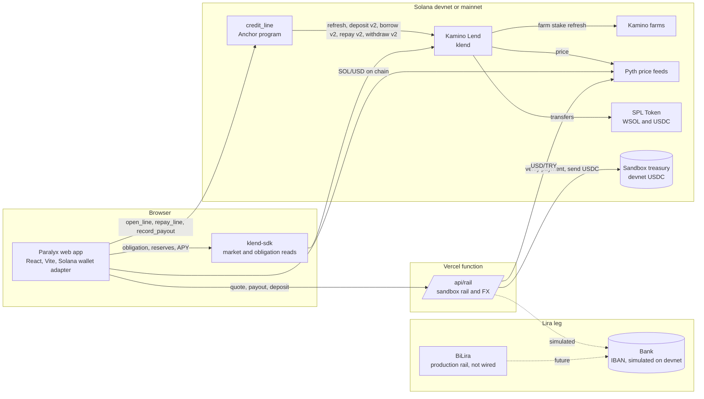
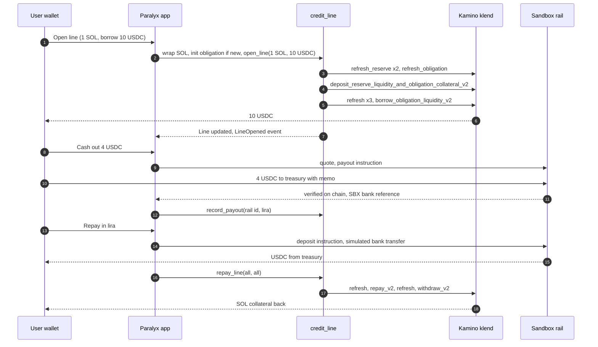

<p align="center"></p>

# Paralyx

**Turkish lira liquidity without selling your SOL.** Post SOL as collateral to a Kamino Lend market, borrow USDC, cash the USDC out as lira through a fiat rail, repay in lira. Paralyx is non-custodial software: the Kamino obligation belongs to the user's wallet, the Kamino market is the lender, a regulated rail is the fiat party, and the Paralyx program never holds funds.

Live app: [paralyx.wienerlabs.xyz](https://paralyx.wienerlabs.xyz) · Program (devnet): [`PLXama5S…yG6qr`](https://explorer.solana.com/address/PLXama5SomfMXpUzgwAVhDXMJrESMX8JP93RGRyG6qr?cluster=devnet) · Source: this repository, branch `solana-port`

> One switch in the top bar, two networks. **Devnet** is the working deployment: the Paralyx program composes Kamino's real klend program on devnet against a SOL and USDC market priced by live Pyth feeds, and the lira leg is a sandbox rail that is labeled as such on every screen. **Mainnet** is read only: the app shows Kamino's Main Market live, the Paralyx program is not deployed there yet, and the production lira rail (BiLira) is a stub with its remaining work listed in the app.

## Contents

1. [Özet (TR)](#özet-tr)
2. [What the user does](#what-the-user-does)
3. [Proof on devnet](#proof-on-devnet)
4. [Architecture](#architecture)
5. [Integrations and why they are load-bearing](#integrations-and-why-they-are-load-bearing)
6. [Deployed artifacts](#deployed-artifacts)
7. [The program](#the-program)
8. [Tests](#tests)
9. [The app](#the-app)
10. [The fiat rail](#the-fiat-rail)
11. [Choosing the network](#choosing-the-network)
12. [Run it](#run-it)
13. [Design decisions](#design-decisions)
14. [Regulatory posture](#regulatory-posture)
15. [Roadmap](#roadmap)
16. [Lineage](#lineage)
17. [Team](#team)

## Özet (TR)

Paralyx, kripto varlığını satmak istemeyen ama liraya ihtiyacı olan kullanıcı için teminatlı likidite hattı. SOL teminat olarak Kamino Lend piyasasına konur, USDC borç alınır, USDC lira rayı üzerinden IBAN'a lira olarak ödenir. Geri ödeme yine lirayla yapılır: raya lira yatırılır, gelen USDC borcu kapatır, teminat serbest kalır. Paralyx hiçbir noktada fon tutmaz; Kamino obligation'ı kullanıcının cüzdanına aittir, kredi karşı tarafı Kamino piyasası, lira bacağı düzenlenmiş taraftır. Devnet'te tam döngü Kamino'nun gerçek klend programı ve canlı Pyth fiyatlarıyla çalışır; lira bacağı her ekranda sandbox olarak etiketlenmiş bir simülasyondur. Mainnet'te uygulama Kamino Main Market'i salt okunur gösterir; üretim lira rayı için BiLira taslağı ve kalan işler uygulamada listelidir.

## What the user does

1. **Connect a wallet** through the Solana wallet adapter: Phantom, Solflare or Backpack. On devnet the app can request SOL from the devnet faucet.
2. **Open a line.** One transaction, one signature: the app wraps the SOL, creates the user's Kamino user metadata and vanilla obligation the first time, and calls `open_line`. Inside that instruction the Paralyx program refreshes both Kamino reserves and the obligation, deposits the SOL as collateral, refreshes again and borrows USDC. USDC lands in the wallet.
3. **Cash out.** The rail quotes USD/TRY plus a 50 bps fee, returns a payout instruction (treasury address and memo), the user sends the USDC with that memo, the rail verifies the transfer on chain and returns a bank reference. On devnet the payout is simulated and the reference starts with `SBX-`. The app records the payout with `record_payout`.
4. **Repay in lira.** The rail returns deposit instructions, the sandbox simulates the bank transfer and sends USDC from its devnet treasury, and one transaction repays the Kamino debt and, if the debt is closed, withdraws all collateral and unwraps it back to SOL. When the wallet already holds enough USDC, the app skips the rail and repays directly.
5. **Withdraw collateral** at any time the health factor allows, through `repay_line(0, ctokens)`; withdrawing everything waits until the debt is repaid.

## Proof on devnet

The full loop ran on devnet on 9 October 2026: deploy, configure, connect, open a line, sandbox cash-out, lira repayment, reopen. The app steps ran in a browser against a local production build with the wallet adapter's burner wallet (`HkjN4VM1PLwTrMUZnEndkUx7CJmnSnXwCgnVVUuwdN5e`, funded from the deployer), without reloading between steps; the public site is the same build without the burner wallet.

| Step | Signer | Transaction |
|---|---|---|
| Deploy `credit_line` | deployer | [`4VCqjXWX…`](https://explorer.solana.com/tx/4VCqjXWXUVfZUvc73xDGcYhxkBLB1xA6shpaLeXUwK95uuWK2FUZYD1pU6UHy4ybnhn2KNWi17Nu2dDBbbV7L5vd?cluster=devnet) |
| `initialize`: config with the klend program, the market and both reserves | upgrade authority | [`r17ASwnd…`](https://explorer.solana.com/tx/r17ASwndoJgv8WRDKducqaisxzwMuF5n63jcukKEdpX9LAdgFt21fwD6kfq42EGkYXnXh52r3foQ3E6RUn69NWB?cluster=devnet) |
| Sandbox treasury USDC account and fee SOL | deployer | [`45xPk7Lo…`](https://explorer.solana.com/tx/45xPk7LoYQcB2xtGH42kbRbZ37h2nVK1SBda8VAbmYkNAU534G8ZXWpv86swa7o6Bq95KHyfdhTdREHRKHA3pBoc?cluster=devnet) |
| `open_line` from `scripts/open-line.mjs`: 1 SOL in, 20 USDC out | deployer | [`37wDTyp8…`](https://explorer.solana.com/tx/37wDTyp8N3eMDbyVWsp2y5acLhM4ZWVrCYzAnCPjeVUr9GGc8L2Am1PWTGBWLVwFd9TkU2uTgxRHdLwAvkN9Axqj?cluster=devnet) |
| Those 20 USDC become the sandbox treasury float | deployer | [`ZAoo6ATj…`](https://explorer.solana.com/tx/ZAoo6ATjkMu8ri6UFU17D2zm2jtuY57TTT4UUu3mZepPFSRCZXgjvd6rkVW1qtYzKCfBL4eG7pDgs4HMDaGqUKP?cluster=devnet) |
| App: open a line, 1 SOL in, 10 USDC out, one signature | test wallet | [`4UTFdUGf…`](https://explorer.solana.com/tx/4UTFdUGfxLK1bTar5S2RYN5P6XhM6btJNYREhpbvqVbWQUzCkqeqGabQfndmoHDZS6kjUGwen1Qmg86fLoLnYxN5?cluster=devnet) |
| App: cash out 4 USDC to the sandbox rail with memo `SBX-PO-B7C18EB276` | test wallet | [`4AmAjSSb…`](https://explorer.solana.com/tx/4AmAjSSbryGWKpHtDmgAk6YdvpDcrD7RSHeUjE6ndrzSc74NpKLSRtJeFKPZtugFn2L6oGdZHhGjLZJJaHygqJra?cluster=devnet) |
| App: `record_payout` of ₺196.34 for rail order `SBX-PO-B7C18EB276` (simulated bank reference `SBX-444E0A0A6F`) | test wallet | [`2Ttjg9yq…`](https://explorer.solana.com/tx/2Ttjg9yqJ7XPGgb6TWfhBwVEJLpvEuLqegToMpDqeq5r3kJAdkgjWFCNouPD7tUhvKX6a3jkM25B2davfi4rAyW4?cluster=devnet) |
| Rail: settle a simulated ₺499 deposit (`SBX-DP-ED0DF3D9E8`) with 10.0645 USDC from the treasury | sandbox rail | [`4R9dQ4QU…`](https://explorer.solana.com/tx/4R9dQ4QU1xnNtLnsr56NAj7igHnHs3iPGUqjcrjSgfncgLQuQ1TC4WBYyxpd96XTNkGmqB6SKjW5PScBKkH7hTEC?cluster=devnet) |
| App: `repay_line(u64::MAX, u64::MAX)`: 10.000002 USDC repaid, 1 SOL back, Kamino closes the obligation | test wallet | [`5eTpayvV…`](https://explorer.solana.com/tx/5eTpayvV6dujtzZLpkRK1rDdSaj5j3GuJuL4jio1kSVRRwGux6MzureyEDrhFk28Xu9Smj9oWnfGTppwGAw5qm84?cluster=devnet) |
| App: open again, 0.5 SOL in, 5 USDC out; the obligation is re-created in the same transaction | test wallet | [`4ePNy9fq…`](https://explorer.solana.com/tx/4ePNy9fqzJEaQbhd55ZJqjxTDKcxY9bQfVTc8Mja6yQ971ztt5aCaBdL2fa4DRDaAV8vLarvVM2coPtXith6B52W?cluster=devnet) |

`node scripts/events.mjs devnet` decodes the program's events from those transactions: `LineOpened` (1,000,000,000 lamports, 10,000,000 USDC units), `PayoutRecorded` (19,634 kuruş, `SBX-PO-B7C18EB276`), `LineRepaid` (10,000,002 USDC units, 1,000,000,000 lamports). The deployer's line (1 SOL, 20 USDC) and the test wallet's second line (0.5 SOL, 5 USDC) stay open, so the Market and Activity pages show live data. No lira moved at any point: the cash-out and the deposit are simulated by the sandbox rail.

Every `open_line`, `repay_line` and `record_payout` emits an event through Anchor's `emit_cpi`. The Activity page reads them from RPC (program signatures, then the program's self-invocations in each transaction), and the Market page builds the cumulative lira and USDC charts from them.

## Architecture





## Integrations and why they are load-bearing

| Piece | Role | Without it |
|---|---|---|
| **Kamino Lend** (`klend`, `KLend2g3cP87fffoy8q1mQqGKjrxjC8boSyAYavgmjD`) | Credit engine: collateral and debt accounting, interest, LTVs, liquidations, oracle checks | No credit. Paralyx never reimplements lending math |
| **Pyth** | SOL/USD and USDC/USD for Kamino's reserves and for the app (on-chain push feed `7UVimf…`); Hermes for history | No prices, Kamino refuses to refresh |
| **Solana wallet adapter** | Phantom, Solflare and Backpack through Wallet Standard, plus the adapters' install links | Manual wallet plumbing |
| **FiatRail** (sandbox on devnet, BiLira stub on mainnet) | Lira out and lira in behind one interface | No lira. The product would be a Kamino front end |
| **klend-sdk** | Health factor, LTV, liquidation LTV and APYs from the user's obligation and the market's reserves | The app would reimplement Kamino's math |

## Deployed artifacts

| Artifact | Network | Address |
|---|---|---|
| Paralyx program `credit_line` | devnet | [`PLXama5SomfMXpUzgwAVhDXMJrESMX8JP93RGRyG6qr`](https://explorer.solana.com/address/PLXama5SomfMXpUzgwAVhDXMJrESMX8JP93RGRyG6qr?cluster=devnet) |
| Program data | devnet | `9wsC8YmEb2jt9jfraBUYc4yTJUdTidSJNyN6N1n7aGaj` |
| Upgrade authority (deployer) | devnet | `JCL5Xpx2ff3aAZMvJ9Rm39kmjsSnL28vD9AxBJ1opBva` |
| Deploy transaction | devnet | [`4VCqjXWX…`](https://explorer.solana.com/tx/4VCqjXWXUVfZUvc73xDGcYhxkBLB1xA6shpaLeXUwK95uuWK2FUZYD1pU6UHy4ybnhn2KNWi17Nu2dDBbbV7L5vd?cluster=devnet), slot 509,223,802 |
| `Config` PDA | devnet | `9DktwSfvbaWa3TwH19fYCCHdaj6m8EudG7i91kjfijYx` |
| Event authority PDA | devnet | `F1pRTfwrXi5jULzbJ2T2PV4oYAyWfbqXr7qVurE13q8z` |
| Address lookup table | devnet | [`65qPaimB5uhZ1TADzMY2wwvgqnZbBoNdFQsYcBTFEzLK`](https://explorer.solana.com/address/65qPaimB5uhZ1TADzMY2wwvgqnZbBoNdFQsYcBTFEzLK?cluster=devnet), 28 addresses |
| Sandbox rail treasury | devnet | `G1gP9iSfZ5xFjikdGfBc1rb5vs6ypvMP8xuwTdBCgg2c` |
| Kamino klend program | devnet and mainnet | `KLend2g3cP87fffoy8q1mQqGKjrxjC8boSyAYavgmjD` |
| Kamino lending market | devnet | `4GiGCkrwHphwrsG8imKSHhjTtmbjorqYrYwMsRtBu77Z` |
| SOL reserve, USDC reserve | devnet | `4yh877FXQrfGWLvvEV2QXNUQh4gBN4Q7gcM7Fz4uAnUs`, `DJ8gPwXaEX2T8ZJGwZNJc9vL6iwrUUyUrwzeSgjD8RHH` |
| Circle devnet USDC mint | devnet | `4zMMC9srt5Ri5X14GAgXhaHii3GnPAEERYPJgZJDncDU` |
| Kamino Main Market (read only) | mainnet | `7u3HeHxYDLhnCoErrtycNokbQYbWGzLs6JSDqGAv5PfF` |
| Web app | Vercel | [paralyx.wienerlabs.xyz](https://paralyx.wienerlabs.xyz) |

The deployed binary is 380,992 bytes, sha256 `40db4ee6663f78ad7a9b42c60474a2a7a4bc0789c54aed190be888ba7bfd7be3`, built with Anchor 1.2 and platform tools v1.57 from the program source at commit `1561b2d`. `solana program dump PLXama5SomfMXpUzgwAVhDXMJrESMX8JP93RGRyG6qr credit_line.so -u devnet` returns the same bytes. The build is not reproducible bit for bit on another machine; a verifiable build (`solana-verify`, Docker) is on the mainnet checklist.

## The program

`contracts/credit_line` is an Anchor 1.2 program. It is a thin composition layer over Kamino: all value moves between the user's token accounts and the Kamino reserves inside Kamino's own instructions; Paralyx validates the accounts, sequences the CPIs, records the line and emits events.

| Instruction | Signer | What it does |
|---|---|---|
| `initialize()` | program upgrade authority | Creates the `Config` PDA: klend program, lending market, collateral reserve, debt reserve. Checks the market and both reserves on chain and refuses a signer that is not the upgrade authority. Runs once |
| `open_line(collateral_amount, borrow_amount)` | user | Refreshes both reserves and the obligation, `deposit_reserve_liquidity_and_obligation_collateral_v2`, refreshes again, `borrow_obligation_liquidity_v2`. A zero amount skips its step; both zero fails with `EmptyRequest` before any CPI. A `borrow_amount` of `u64::MAX` fails with `UnboundedAmount`, because Kamino reads it as "borrow the most the LTV allows". Creates the `Line` PDA on first use, emits `LineOpened` |
| `repay_line(repay_amount, withdraw_ctokens)` | user | Refresh, `repay_obligation_liquidity_v2`, refresh, `withdraw_obligation_collateral_and_redeem_reserve_collateral_v2`. A `repay_amount` of `u64::MAX` repays the whole debt. `withdraw_ctokens` is in Kamino collateral tokens, not lamports (the app converts with the reserve's exchange rate); `u64::MAX` withdraws everything and is accepted only when no debt is left after the repay step, since with open debt Kamino reads it as "the most the LTV allows". Fails with `LineNotFound` before any CPI if the user never opened a line. Emits `LineRepaid` with the lamports actually received |
| `record_payout(rail_tx_id, try_amount)` | user | Records a completed lira payout (kuruş) against the line, emits `PayoutRecorded`. The reference must be 1 to 64 bytes |

Accounts: `Config` (seeds `config`) holds the configuration and `line_count`; `Line` (seeds `line`, user) holds `opened_at`, `updated_at`, `collateral_in`, `collateral_out`, `borrowed`, `repaid`, `payouts`, `payout_try`. Both carry a `version` byte (1) and 64 reserved bytes, so later fields fit without a reallocation and a migration can tell old records from new ones. The Stellar version's views (`get_line`, `get_config`, `get_line_count`, `positions`) are now client-side reads of these accounts and of the user's Kamino obligation; its `upgrade` function is replaced by the program upgrade authority.

Errors start at 7000 so a failure is never confused with klend's own codes, which start at 6000 and surface through the CPI: `EmptyRequest` 7000, `LineNotFound` 7001, `MarketMismatch` 7002, `ReserveMismatch` 7003, `ObligationMismatch` 7004, `UnsupportedObligation` 7005, `InvalidReference` 7006, `NotUpgradeAuthority` 7007, `AmountOverflow` 7008, `UnboundedAmount` 7009.

Patterns worth pointing at:

- **The obligation is the user's.** The program accepts only the user's vanilla Kamino obligation (tag 0, id 0, seeds over the user's wallet and the configured market), checks its owner and market fields, and rejects obligations that hold other reserves or carry a referrer. Kamino itself requires the user's signature on every deposit, borrow, repay and withdraw; the user signs once and the signature carries through the CPI. No Paralyx PDA ever owns a position or a token account.
- **v2 handlers, not v1.** In klend's source (v1.25.0), the v1 handlers run `check_refresh`, which inspects the transaction's instruction list and rejects CPI from programs outside Kamino's whitelist. The v2 handlers refresh farms themselves and accept CPI, so the program performs the refreshes as CPIs in the same instruction. The v2 path runs against the mainnet klend binary in every test.
- **Measured accounting.** The line records the balance changes of the user's own token accounts, not the requested amounts. Kamino rounds a 1 SOL deposit to 999,999,999 lamports and clamps repayments; the line shows exactly what moved.
- **Events survive Kamino's logs.** Kamino logs heavily, and Solana truncates logs at 10 KB. `emit_cpi` puts the events in a self-invocation instead of the log.
- **Kamino closes an emptied obligation** and refunds its rent; the app re-creates it on the next open.

Limits and trust, stated plainly:

- **The upgrade authority is the custody boundary.** Users sign transactions that call this program, and their signature carries into its CPIs, so whoever can upgrade the program could ship code that moves what those transactions can reach. On devnet the deployer key holds the authority. Before mainnet it moves to a multisig with a timelock, or the program is made immutable with `solana program set-upgrade-authority --final`.
- **Obligations with a referrer are refused.** A user whose Kamino obligation was opened through a referral link gets `UnsupportedObligation`; supporting them means passing the referrer accounts through.
- **Payout counters are self-attested.** `record_payout` is signed by the user. The sandbox rail checks the transfer before it issues an `SBX-` reference, but the program does not verify the reference; `payouts` and `payout_try` say what the user's rail reported. A production rail would co-sign records with its own key.
- **Compute and size.** In the tests `open_line` consumes about 267,000 compute units and `repay_line` about 247,000. A legacy message with only `open_line` is 1,004 bytes; with the client's wrapping, ATA and setup instructions it would pass Solana's 1,232-byte limit, so the app requests 1,000,000 units and sends version 0 transactions through an address lookup table.

## Tests

`anchor test` builds the program and runs fourteen LiteSVM tests (`contracts/credit_line/tests/credit_line.rs`) against the real klend and farms programs and a single-slot snapshot of Kamino's mainnet Main Market: the lending market, the SOL and USDC reserves with their vaults and mints, Scope prices and the SOL collateral farm. `contracts/fixtures/fetch.mjs` dumps the two program binaries and fetches the accounts in one `getMultipleAccounts` call so the reserves and vaults agree; the snapshot is not committed because the klend binary is BUSL licensed and ten megabytes. The script records the slot, the cluster's block time and the sha256 of both binaries. The last run used slot 454,900,180 (block time 2026-10-09 14:56:14 UTC), klend `ac5a94790923b0a8cccb981e6f20b5bbb4a67ae35490b685db3009b144771009` and farms `766533347d1e477537185192a8018962150898d457a0e4e98c0c5a2ba9133afd`.

| Test | Ported from |
|---|---|
| `open_line_deposits_sol_and_borrows_usdc_on_kamino` | `open_line_forwards_collateral_and_borrow_to_pool` |
| `open_line_requires_user_signature` | `open_line_requires_user_auth` |
| `open_line_rejects_empty_requests_and_foreign_reserves` | `open_line_rejects_empty_and_negative_requests` |
| `second_open_aggregates_without_counting_a_new_line` | `second_open_aggregates_without_double_counting_lines` |
| `repay_line_repays_debt_and_withdraws_collateral` | `repay_line_forwards_repay_and_withdraw` |
| `repay_without_line_fails` | `repay_without_line_fails` |
| `record_payout_updates_line_and_requires_line` | `record_payout_updates_line_and_requires_line` |
| `config_and_positions_are_client_side_reads` | `positions_reads_through_to_pool_and_config_is_stored` |
| `initialize_requires_upgrade_authority` | new |
| `initialize_rejects_reserves_of_another_market` | new |
| `open_line_rejects_unbounded_borrow` | new |
| `repay_line_withdraws_exact_ctokens_and_rejects_unbounded_withdraw_in_debt` | new |
| `open_line_rejects_foreign_and_referred_obligations` | new |
| `line_seeds_bind_payouts_and_repayments_to_the_signer` | new |

`node --test` in `scripts/` adds four client checks: the sandbox rail's repayment guard against a stubbed obligation, transaction confirmation without websockets, events paired with their own transaction when the RPC answers a batch out of order, and the `@solana/web3.js` load path that Vercel's runtime uses.

Amounts are `u64`, so the Soroban `NegativeAmount` check cannot be expressed; its test now covers a swapped reserve pair, and the payout test covers empty and oversized references.

## The app

The five screens, the layout, the Sora typeface, the lavender accent, the TR and EN copy and the dark theme are unchanged. What changed is underneath:

- **Panel.** Available lira limit from the obligation's borrow limit, collateral in SOL, debt in USDC, health factor with LTV and liquidation LTV, live USD/TRY and SOL/USD charts, lines opened per hour, recent activity.
- **Piyasa.** The Kamino market's active reserves: price, supplied, borrowed, utilization, supply and borrow APY, maximum LTV and liquidation LTV, market status. Below it, Paralyx's hourly and cumulative lira payouts and cumulative USDC borrowed, from program events.
- **Hareketler.** Protocol totals and the event feed, filterable to your address, every row linked to Solana Explorer.
- **Hat aç.** Devnet SOL faucet, the collateral and borrow form with the borrow limit preview, the collateral withdrawal card, the roadmap.
- **Takas.** Cash out and repay in lira through the rail; on mainnet, the BiLira card with its open work.

Data sources: Kamino reserves and the user's obligation through klend-sdk (`web/src/lib/kamino.ts`, loaded on demand); SOL/USD from Pyth through the rail function (Hermes), with Pyth's on-chain push feed as the fallback; USD/TRY and price history from the rail function (`web/api/rail.ts`). Transactions are built in `web/src/lib/paralyx.ts`, which the Node scripts import too, and sent as version 0 transactions with an address lookup table that holds the program, market, reserve, vault, mint and oracle accounts.

klend-sdk 13 imports three helpers from kliquidity-sdk, which pulls in Orca's WebAssembly bindings with a top-level await that Vite cannot bundle. The build aliases kliquidity-sdk to `web/src/shims/kliquidity.ts`, which reimplements those helpers line for line.

## The fiat rail

`web/src/lib/rail.ts` defines `FiatRail`: `quote`, `startPayout`, `confirmPayout`, `startDeposit`, `settleDeposit`. Two implementations:

- **SandboxRail** (devnet). Backed by `web/api/rail.ts`, served at `/api/rail` by a Vercel function and by the Vite dev and preview servers. Quotes USD/TRY plus 50 bps. A payout returns an HMAC-signed instruction; after the user's transfer, the server reads the transaction from devnet and checks the USDC amount, the treasury token account, the authority and the memo before it returns an `SBX-` reference. A deposit is settled by a transfer from the sandbox treasury tagged with the deposit id, so a retry after the first settlement confirms returns that transfer instead of paying again; the instruction expires after 15 minutes. The treasury only pays repayments: when the instruction is issued and again before it pays, the server reads the wallet's Kamino obligation and requires USDC debt in the configured market, a wallet balance below that debt, and an amount no larger than the debt plus 2% and 1.5 USDC (so the 50 TRY minimum still clears a small debt). The sandbox does not lock concurrent settle calls, which is acceptable only because it moves devnet USDC. Every screen, receipt and reference says that no lira moved.
- **BiLiraDirectRail** (mainnet). A stub that throws `RailNotWired` and carries the production work as data, rendered on the mainnet Takas screen: partner agreement and API access, KYC at BiLira, quote, USDC or TRYB (`A94X2fRy3wydNShU4dRaDyap2UuoeWJGWyATtyp61WZf`) payout to the user's own IBAN with a webhook reference, lira deposit to USDC, `record_payout` with BiLira's order id, and confirmation of BiLira's final authorization.

USD/TRY: Pyth publishes `FX.USD/TRY` (feed `032a2eba…e058`), but Hermes has required an API key since 26 August 2026 and FX feeds need an FX entitlement on that key. With `PYTH_API_KEY` set and entitled, the rail uses Pyth; otherwise it falls back to the previous source, Reflector's FX oracle, read server side. The current key is entitled for crypto feeds only, so SOL history comes from Pyth and USD/TRY from Reflector.

## Choosing the network

Kamino's klend program is deployed on devnet under the mainnet program id. A scan of its devnet accounts found 174 lending markets; most are stale tests. `refresh_reserve` was simulated against every devnet market that has both a SOL reserve and a reserve for Circle's devnet USDC (`4zMMC9…DncDU`). Market `4GiGCkrwHphwrsG8imKSHhjTtmbjorqYrYwMsRtBu77Z` passed for both reserves on Pyth's devnet push feeds (SOL/USD `7UVimf…`, USDC/USD `Dpw1EA…`), has no farms or elevation groups in the way, and had about 67 USDC available to borrow when it was chosen. It is small: the lines opened for the proof above use part of that liquidity. It is a third-party test market on Kamino's devnet deployment, not a market Kamino operates; its owner can change it. Paralyx runs on devnet against it, and the program's tests run against Kamino's mainnet Main Market instead, so the mainnet path is covered too. The staging program `SLendK7y…FJSh` was not needed.

## Run it

```
contracts/            Anchor workspace: credit_line program, LiteSVM tests, mainnet fixtures script
web/                  React + Vite app, Vercel function for the rail (api/)
scripts/              Node helpers: devnet setup, open a line, repay, cash out, decode events
docs/brand/           Paralyx marks
```

### Program

```bash
cd contracts
anchor build
anchor test
```

`anchor test` fetches the mainnet fixtures on first run (`node fixtures/fetch.mjs`, pass `--refresh` to update them) and runs `cargo test`. Requirements: Anchor CLI 1.2, Solana CLI 4.1 with platform tools v1.57 (the program builds as SBPF v3, active on devnet and mainnet), Rust 1.98.1 for the host side.

Deploy and configure on devnet (the keypair paths are examples):

```bash
solana program deploy target/deploy/credit_line.so --program-id target/deploy/credit_line-keypair.json --keypair <deployer.json> -u devnet
node ../scripts/setup-devnet.mjs <deployer.json> <treasury.json>
```

`setup-devnet.mjs` initializes the config, creates the address lookup table and prepares the sandbox treasury's USDC account.

### App

```bash
cd web
npm install
npm run dev
```

Server environment for the rail (`web/.env.local` locally, project settings on Vercel): `SANDBOX_TREASURY_SECRET` (the devnet treasury keypair as a JSON array), `RAIL_RPC` (devnet RPC), `PYTH_API_KEY` (optional). `VITE_BURNER_WALLET=1` adds the wallet adapter's burner wallet on devnet for local testing; never set it for a public build.

### Scripts

```bash
node scripts/open-line.mjs <keypair.json> 1 10        # 1 SOL collateral, borrow 10 USDC
node scripts/cashout.mjs <keypair.json> 4 <rail url>  # sandbox cash-out and record_payout
node scripts/repay.mjs <keypair.json> max max         # repay everything, withdraw everything
node scripts/events.mjs devnet                        # decode program events
```

The scripts import `web/src/lib`, so install the web dependencies first.

## Design decisions

- **Compose on Kamino instead of writing a pool.** Kamino already runs reserves, rate curves, oracle checks and liquidations on Solana. Paralyx stays small enough to read in one sitting.
- **User owns the position.** The obligation is the user's vanilla obligation; if Paralyx disappears, the position is still visible and manageable in Kamino's own app.
- **CPI through the v2 handlers.** Keeps the one-transaction, one-signature flow of the Stellar version without asking Kamino to whitelist the program.
- **Measured amounts in the line.** Fixes the Stellar version's limitation that line totals were requested amounts.
- **Events through CPI.** Robust to log truncation, readable from transaction metadata.
- **Wrapping and ATAs in the client.** SOL is wrapped and unwrapped in the same transaction by the user's own instructions; the program stays a router.
- **One rail interface.** The sandbox and the production rail share `FiatRail`, so the Takas screen does not change when BiLira is wired.
- **Sandbox is never real.** The `SBX-` prefix, the badge, the receipt note and the README all say so.
- **Renamed field.** `anchor_tx_id` is now `rail_tx_id`: the Stellar anchor no longer exists, the rail does.
- **Renamed argument.** DEVIATION: `repay_line`'s `withdraw_collateral` is now `withdraw_ctokens`, because Kamino withdraws in collateral tokens and a lamport-looking name invited a wrong amount. The `LineRepaid` event keeps `withdraw_collateral` and reports the lamports received.
- **Exact amounts only.** `u64::MAX` is Kamino's "as much as allowed"; the program accepts it only where it means "all of it": repaying the debt, and withdrawing once the debt is gone.

## Regulatory posture

Paralyx is non-custodial software. It never holds user funds, never sets rates and is not the lender; the Kamino market is the counterparty and the obligation belongs to the user. It never touches lira: the regulated fiat party does KYC, AML and bank settlement. For production that party is BiLira: Bilira Kripto Varlık Alım Satım Platformu A.Ş., the issuer of the TRYB lira stablecoin, which redeems TRYB to the holder's own bank account. As of 1 October 2026 BiLira appears on the Capital Markets Board's provisional list of crypto asset service providers operating under the transitional provision of Law 6362; its operating license application was completed in July 2025, and the final authorization has not been verified. No public BiLira off-ramp API was found, so the integration needs a partner agreement. The devnet sandbox moves only devnet USDC and simulates the bank; it is not a payment service. Before mainnet: an audit of `credit_line`, a legal opinion on the CASP framework of Law 7518 and on consumer credit marketing, and BiLira's final authorization.

## Roadmap

1. **BiLira production rail.** Wire `BiLiraDirectRail` behind the existing interface once a partner agreement and API access exist.
2. **Mainnet.** Deploy the same program against Kamino's Main Market after an audit; the tests already run against it.
3. **Pyth FX entitlement.** Move USD/TRY from Reflector to `FX.USD/TRY` on an entitled key.
4. **Omnichain entry.** USDC from other chains through Circle CCTP.
5. **Health guardian.** Alerts and a one-click top-up when the health factor drops.

## Lineage

- **2025: Paralyx LSD prototype on Stellar** ([paralyx-LSD/paralyx-protocol](https://github.com/paralyx-LSD/paralyx-protocol)): Ethereum liquid staking tokens bridged to a Soroban lending pool.
- **September 2026: Paralyx on Stellar**, the rebuild around Blend v2 and a SEP-6 TRY anchor, built at the Rise In x Stellar Pro Hackathon in Istanbul. Preserved at tag `stellar-v1` (testnet contract `CDZ22YMZ…L5Z4B`, mainnet contract `CDCYHJPS…C7ITC`), including the demo narration, jury notes and pitch material.
- **October 2026: Paralyx on Solana**, this branch: same product, brand and screens, with Kamino Lend as the credit engine, the Solana wallet adapter, Pyth prices and a rail interface for the lira leg.

## Team

Baturalp Güvenç (program, app, integrations) and Abdullah Valisoy (product and presentation).

## License

MIT
